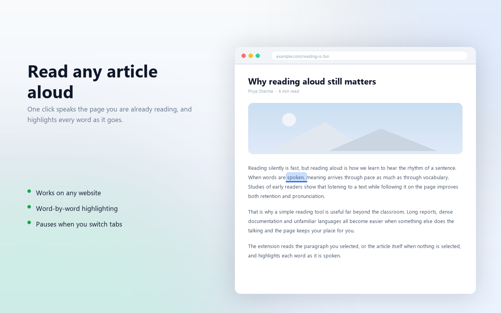
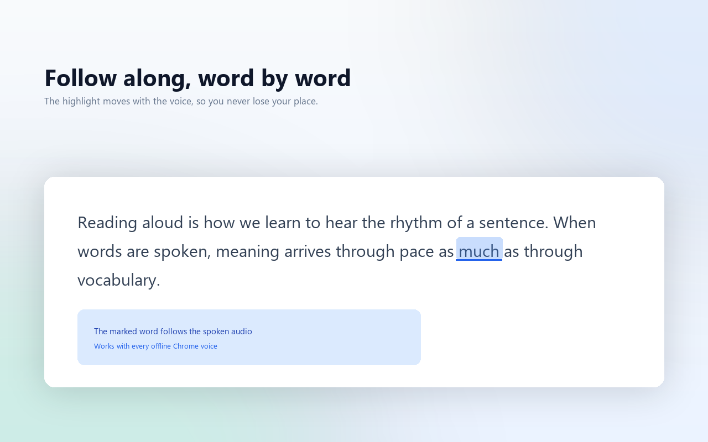
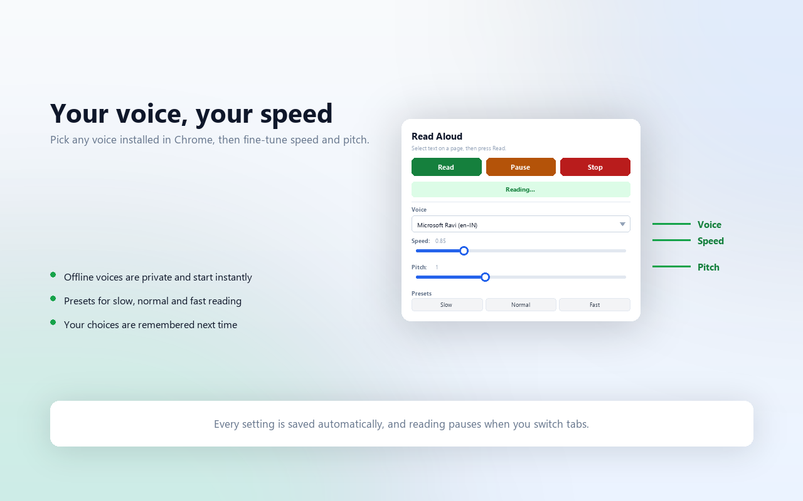
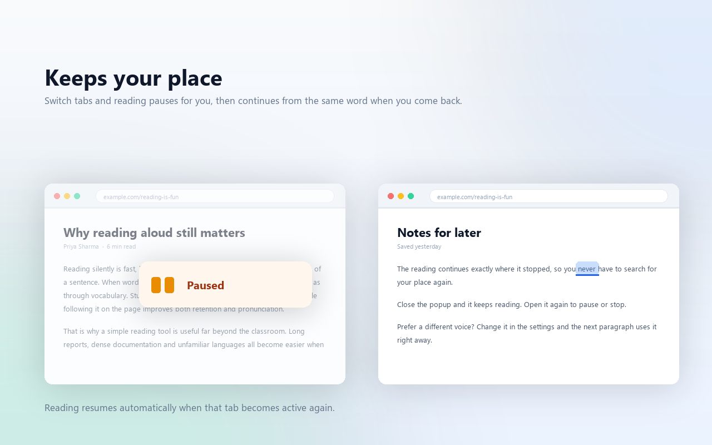
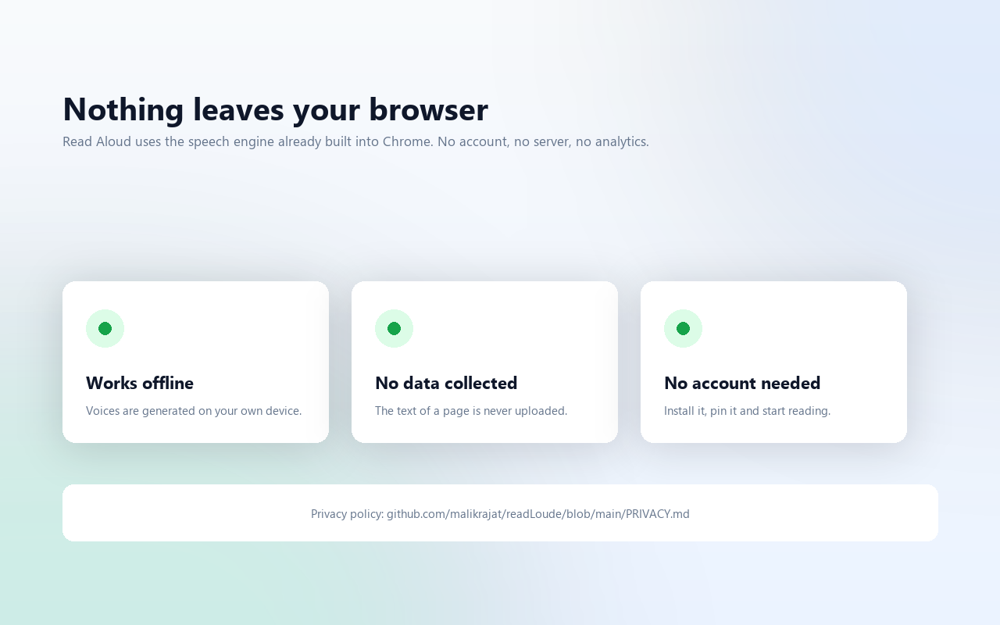

# Read Aloud with Highlight

<p align="center">
  
  
  
  
  
  
  
  
  
  
  
  
  
  
  
  
  
  
  
  
  
  
  
  
  
  
  
  
  
  
</p>

<div align="center">
  <h3>
    <a href="#installation">Install</a>
    •
    <a href="https://github.com/malikrajat/readLoude">Source Code</a>
    •
    <a href="./docs/README.md">Documentation</a>
    •
    <a href="#screenshots">Screenshots</a>
  </h3>
</div>

<div align="center">
  <p>
    <strong>Private by Design</strong> ·
    <strong>Word-by-Word Highlighting</strong> ·
    <strong>Offline Voices</strong> ·
    <strong>Keyboard First</strong> ·
    <strong>Accessible</strong>
  </p>
</div>

## See It In Action

<div align="center">

  

</div>

Read Aloud with Highlight is a Chrome extension (Manifest V3) that reads a page — or just the text you selected — out loud and highlights every word as it is spoken. It uses the speech engine already built into Chrome, so there is no server, no account and nothing to install beyond the extension itself.

## Table of Contents

- [Install](#installation)
- [Quick Start](#quick-start)
- [Usage](#usage)
- [Features](#features)
- [Settings](#settings)
- [Screenshots](#screenshots)
- [Code Examples](#code-examples)
- [Use Cases](#use-cases)
- [How It Works](#how-it-works)
- [FAQ](#faq)
- [Performance & Resource Use](#performance--resource-use)
- [Testing](#testing)
- [Migration & Versioning](#migration--versioning)
- [Troubleshooting](#troubleshooting)
- [API Reference Quick Start](#api-reference-quick-start)
- [Best Practices](#best-practices)
- [Project Structure](#project-structure)
- [Permissions and Privacy](#permissions-and-privacy)
- [Discoverability](#discoverability)
- [Development](#development)
- [Releasing a New Version](#releasing-a-new-version)
- [Known Limitations](#known-limitations)
- [Documentation](#documentation)
- [Changelog](#changelog)
- [License](#license)

## Install & Explore

| | |
| --- | --- |
| <a href="#installation" target="_blank"></a><br/><br/><sub><b>Install from Source</b></sub><br/><sub>Clone, build and load the unpacked extension</sub> | <a href="./docs/README.md" target="_blank"></a><br/><br/><sub><b>Documentation Index</b></sub><br/><sub>Guides, audits and policy notes</sub> |
| <a href="#screenshots" target="_blank"></a><br/><br/><sub><b>Screenshots</b></sub><br/><sub>The real popup, highlighting and offline story</sub> | <a href="./test-page.html" target="_blank"></a><br/><br/><sub><b>Manual Test Page</b></sub><br/><sub>Edge cases, long text, RTL and repeated words</sub> |
| <a href="https://github.com/malikrajat/readLoude" target="_blank"></a><br/><br/><sub><b>Source Code</b></sub><br/><sub>Star, fork and contribute</sub> | <a href="./CHANGELOG.md" target="_blank"></a><br/><br/><sub><b>Release Notes</b></sub><br/><sub>What shipped in 1.0.0 and why</sub> |
| <a href="./PRIVACY.md" target="_blank"></a><br/><br/><sub><b>Privacy Policy</b></sub><br/><sub>What is handled, where and for how long</sub> | <a href="./store/listing.md" target="_blank"></a><br/><br/><sub><b>Store Listing</b></sub><br/><sub>Copy, permission justifications and reviewer notes</sub> |

## Quick Start

Read Aloud with Highlight is a small, dependency-free extension written in plain JavaScript. It reads the current selection — or detects the main article when nothing is selected — using Chrome's built-in `speechSynthesis` engine, marks the word being spoken, and pauses automatically when you leave the tab. The page text never leaves your device: there is no backend, no analytics, no account and no network request anywhere in the package.

The repository contains the whole extension (four scripts, one stylesheet, one popup and four icons), a 145-test suite, a store-listing validator, a reproducible package build and a release workflow. There is no bundler: `npm run create` copies the runtime files into `dist/`, and that folder is exactly what gets published.

### Installation

The Chrome Web Store listing is being prepared. Until it is live, install the unpacked build:

```bash
git clone https://github.com/malikrajat/readLoude.git
cd readLoude
npm ci
npm run create
```

Then open `chrome://extensions`, turn on **Developer mode**, click **Load unpacked** and select `dist/unpacked`. Optionally enable **Allow access to file URLs** on the extension details page to read local HTML files.

### Basic Usage

```text
1. Open any article, documentation page or blog post.
2. Select a paragraph, or select nothing to read the whole article.
3. Press Alt+Shift+R (or click the toolbar icon).
4. Press Read. Use Pause and Stop at any time.
```

Reading pauses on its own when you switch tabs and continues when you come back. Every spoken word is highlighted, and the page only scrolls when the next word would otherwise leave the screen.

---

## Features

- **Read a selection or the whole article.** If text is selected it is read; otherwise the extension detects the main article of the page using `<article>`/`<main>` containers and a paragraph-density fallback that skips navigation, headers, footers, sidebars and comment sections.
- **Word-by-word highlighting.** The spoken text is mapped exactly onto the selection's text nodes, so the marker follows the audio even when the same sentence appears several times on the page.
- **Correct across inline markup.** A word split across `<strong>`, `<em>` or a link is highlighted as one word instead of being clamped to the first text node.
- **Calm, forward-only scrolling.** A visible word never moves the page, downward scrolls anchor the word at 35% of the viewport, upward scrolls happen only when the word is completely off-screen, and `prefers-reduced-motion` switches to an instant jump.
- **Pause, resume and stop** from the popup. Reading pauses when the tab becomes inactive and resumes when you return, but a pause you asked for is never auto-resumed.
- **Voice, speed and pitch controls**, with Slow / Normal / Fast presets. Values are clamped before they reach `SpeechSynthesisUtterance`, so an old or malformed stored value cannot break playback.
- **Local voices first.** Voices without the `(online)` suffix start instantly, work offline and report the word-boundary events highlighting needs. The default-voice picker prefers a local English voice, then any local voice.
- **Voice settings survive voice-list changes.** The chosen voice is stored by name, with automatic migration from the old index-based value and a sensible local fallback.
- **Long articles do not stop early.** Text above 30,000 characters is split at sentence boundaries, then word boundaries, with the original offsets preserved so highlighting still lines up.
- **Readable interface.** 360 px popup, 14 px base text, 44 px buttons, visible focus rings, light and dark themes, and every foreground/background pair measured at 4.5:1 or better (WCAG AA).
- **Keyboard shortcut** `Alt+Shift+R` opens the popup; the shortcut can be changed at `chrome://extensions/shortcuts`.
- **Settings saved automatically**, debounced by 400 ms and flushed when the popup closes, so dragging a slider cannot exhaust Chrome's `storage.sync` write quota.
- **Works offline** with local voices and remembers your settings between sessions.
- **Private by architecture.** No network calls, no remote code, no analytics, no account, and page text is never written to disk.
- **Least privilege.** `activeTab`, `scripting`, `storage` and the `<all_urls>` host permission required to read the page you chose. No `tabs`, `cookies`, `history`, `webRequest` or `clipboardRead`.
- **Isolated content script.** `"world": "ISOLATED"` means the extension cannot read or change the page's own JavaScript, and the page cannot call into the extension.
- **Non-blocking feedback.** Errors appear as an `aria-live` message in the popup and a short on-page toast — never a blocking `alert()`.
- **Reversible page changes.** At most one hidden marker and one highlight box are added while reading, and cleanup removes every trace even after a stale injection.
- **Deterministic tests.** 145 unit and behaviour tests run on Node 20, 22 and 24 with the built-in `node:test` runner; the DOM and `chrome.*` APIs are supplied by a fake harness.
- **Store-ready tooling.** `npm run verify` checks lint, manifest, MV3 CSP, icon dimensions, listing rules, contrast ratios and tests before a release.
- **Zero runtime dependencies, no bundler.** The repository root is already a valid unpacked extension; the build only copies and zips the publishable files.
- **First public release.** Version 1.0.0, documented in [CHANGELOG.md](./CHANGELOG.md), with the audit in [docs/code-review.md](./docs/code-review.md).

---

## Quick Start Guide

### 1. Installation

#### From the Chrome Web Store

Once the listing is live, open it and click **Add to Chrome**.

<!-- Replace with your listing URL after publishing. -->

#### From source (developer mode)

1. Open `chrome://extensions`.
2. Turn on **Developer mode** (top right).
3. Click **Load unpacked** and select this folder, or `dist/unpacked` after `npm run create`.
4. Optionally open the extension details and enable **Allow access to file URLs** if you want to read local HTML files.

Loading `dist/unpacked` rather than the repository root means you test exactly the files that get published.

### 2. Read Your First Page

1. Open any article, documentation page or blog post.
2. Select the text you want to hear, or select nothing to read the whole article.
3. Click the Read Aloud icon in the toolbar (or press `Alt+Shift+R`).
4. Press **Read**. Use **Pause** and **Stop** at any time.
5. Switch to another tab: reading pauses by itself. Come back and it continues.

If nothing is selected and no article can be detected, the popup tells you to select text instead.

### 3. Common Workflows

| Goal | Do this |
| --- | --- |
| **Study or take notes** | Select a section, press `Alt+Shift+R`, start reading, and type notes while the voice continues. |
| **Proofread your writing** | Select a paragraph and listen for clumsy rhythm; press **Pause** to edit, then start again. |
| **Learn a language** | Pick a voice in that language, lower the speed, and follow the highlight word by word. |
| **Give your eyes a rest** | Select nothing on an article page and let the extension detect the main content. |
| **Check one sentence** | Select exactly that sentence; a selection always wins over article detection. |

### 4. Settings and Presets

| Setting | What it does |
| --- | --- |
| Voice | Any voice installed in Chrome. Voices without the `(online)` suffix are local, start instantly and support word highlighting. |
| Speed | 0.5× – 2×, with Slow / Normal / Fast presets. |
| Pitch | 0.5 – 2. |

| Preset | Speed | Pitch |
| --- | --- | --- |
| Slow | 0.8 | 1 |
| Normal | 0.95 | 1 |
| Fast | 1.1 | 1 |

Settings are saved automatically with a short debounce, so dragging a slider does not spam Chrome's storage quota. The popup defaults to 0.85 speed and pitch 1, and the background worker seeds those defaults on install and update so the controls are never empty.

### 5. Popup States and Keyboard

| State | What the popup shows |
| --- | --- |
| Idle | **Read** enabled, **Pause** and **Stop** disabled, with the hint *Select text on a page (or open an article), then press Read.* |
| Reading | **Pause** becomes **Resume** while paused; **Stop** ends the session. |
| Paused by tab switch | Resumes automatically when the tab becomes active again. |
| Paused by you | Stays paused until you press **Resume**. |
| Error | A specific message in the hint area (`role="alert"`) and, where useful, a non-blocking toast in the page. |

The popup footer reminds you that reading pauses when you switch tabs and that `Alt+Shift+R` opens the popup.

### 6. What Happens Inside the Page

- One hidden `<span id="read-aloud-selection-marker">` marks where the selection started; it is what maps speech offsets back to the page exactly.
- A highlight box follows the word being spoken; it is removed when reading stops, finishes or errors.
- A status toast reports runtime problems without freezing the tab, and it disappears on its own.
- If a page rebuilds its DOM mid-reading, the extension rebuilds its offset map once and then falls back to a forward-only search. Playback is never dependent on the DOM, so the audio continues.

---

## Usage

1. Open any article, documentation page or blog post.
2. Select the text you want to hear, or select nothing to read the whole article.
3. Click the Read Aloud icon in the toolbar (or press `Alt+Shift+R`).
4. Press **Read**. Use **Pause** and **Stop** at any time.

If nothing is selected and no article can be detected, the popup tells you to select text instead.

Pinning the extension to the toolbar makes the one-click path shorter: select a paragraph, press the shortcut, press **Read**. Pause, switch tabs to check something, come back, and the reading picks up where it stopped.

---

## Settings

| Setting | What it does |
| --- | --- |
| Voice | Any voice installed in Chrome. Voices without the `(online)` suffix are local, start instantly and support word highlighting. |
| Speed | 0.5× – 2×, with Slow / Normal / Fast presets. |
| Pitch | 0.5 – 2. |

Settings are saved automatically (with a short debounce, so dragging a slider does not spam Chrome's storage quota).

| Stored key | Type | Default | Purpose |
| --- | --- | --- | --- |
| `voiceName` | `string` | `""` | The chosen voice, matched by name across sessions and machines. |
| `voiceIndex` | `number` | — | The visible list index, kept in sync; also the legacy fallback for builds that stored only an index. |
| `rate` | `number` | `0.85` | Speech speed, clamped to 0.5–2. |
| `pitch` | `number` | `1` | Speech pitch, clamped to 0.5–2. |

---

## Screenshots

| Screenshot | What it shows |
| --- | --- |
|  | **Read any article aloud** — one click speaks the page you are already reading, and highlights every word as it goes. |
|  | **Follow along, word by word** — the marker moves with the voice, so you never lose your place. |
|  | **Your voice, your speed** — pick any voice installed in Chrome and tune speed and pitch. |
|  | **Keeps your place** — reading pauses when you switch tabs and continues when you return. |
|  | **Nothing leaves your browser** — works without a connection and needs no account. |

All store images are 1280×800, 24-bit PNG without transparency, and `npm run check:listing` verifies their dimensions and colour type. Regenerate them with `npm run assets`.

---

## Code Examples

This is an extension rather than a library, so there is no public import to learn. These snippets cover the developer paths you are most likely to need.

### Load the Publishable Build

```bash
npm ci                 # install Biome, the only dev dependency
npm run create         # clean dist/, then build both outputs
```

Then load `dist/unpacked` with **Load unpacked** in `chrome://extensions`.

### Read the Saved Settings from the Popup Console

Open the popup, right-click it, choose **Inspect**, and run:

```js
chrome.storage.sync.get(['voiceName', 'voiceIndex', 'rate', 'pitch'], (settings) => {
  console.log(settings);
});
```

If `storage.sync` is unavailable in the profile, the popup falls back to `chrome.storage.local`; read the same keys from there in that case.

### Ask the Content Script for Its State

```js
const [tab] = await chrome.tabs.query({ active: true, currentWindow: true });
const status = await chrome.tabs.sendMessage(tab.id, { action: 'getStatus' });
console.log(status); // { isReading, isPaused }
```

### Inspect the Highlight While Reading

```js
document.querySelector('.read-aloud-highlight')?.textContent;
document.querySelector('#read-aloud-selection-marker')?.outerHTML;
```

Both elements are removed when reading stops. If the page mutated mid-reading, the extension rebuilds its map once before falling back to a forward-only search.

### Enable Verbose Logging

```js
// content.js — the first tunable
const DEBUG = false; // set to true for detailed page-console logging
```

The popup always logs with the `[Read Aloud]` prefix. Warnings and errors remain visible without the flag.

### Run One Test File

```bash
node --test test/core.test.js
```

Or run the whole suite with `npm test`. The behaviour tests load the real `content.js` and `popup.js` against a fake DOM.

---

## Use Cases

| Audience | How it helps |
| --- | --- |
| **Studying** | Listen to course material or documentation while you take notes, with the marker keeping your place. |
| **Proofreading** | Hearing your own sentences is the fastest way to catch clumsy ones. Pause, edit, and continue. |
| **Language learning** | Compare what you wrote with how it sounds, at a slower speed and in a voice for that language. |
| **Focus and fatigue** | Keep up with long pages when reading on screen is tiring; the extension scrolls forward for you. |
| **Accessibility** | A second way to take in the same page, alongside your screen reader, with high-contrast controls and keyboard access. |
| **Documentation review** | Select one section at a time and let the extension read the exact text you chose. |

---

## How It Works

The architecture is deliberately small, and every decision that can be tested lives in one pure module.

```text
popup.html / popup.js
        │  chrome.tabs.sendMessage({ action })
        ▼
content.js  ──uses──▶  lib/core.js   (pure logic, unit tested)
        │
        ▼
Chrome speechSynthesis + DOM highlight

background.js  ──seeds default settings on install/update──▶  chrome.storage
```

1. **Resolve the text.** The live selection wins, then the last selection tracked in the page, then the selection captured by the popup, then article detection.
2. **Detect the article.** `<article>` and `<main>` elements are tried first when they contain more than 200 characters of text; otherwise paragraph containers are scored while skipping `nav`, `header`, `footer`, `aside`, comments, sidebars and menus.
3. **Build the map.** The selection's text nodes are recorded as `{ node, start, end, dataStart }` entries. Offsets in the spoken text map to exactly one place on the page, which is why repeated text no longer drags the highlight to an earlier copy.
4. **Split long text.** Normal reads use a single utterance. Above 30,000 characters the text is split at `. `, `! `, `? ` or newline boundaries, then at a space, keeping every character and every offset.
5. **Speak.** A 150 ms settle delay avoids Chrome dropping an utterance queued immediately after `cancel()`. A 10-second keep-alive interval works around Chrome stopping long speech at around 15 seconds.
6. **Follow the voice.** `boundary` events report character offsets; the map turns each one into a highlight rectangle and, only when needed, a scroll plan.
7. **Clean up.** Session tokens make callbacks from an older utterance no-ops; one helper clears every timer; every marker, highlight and toast is removed on stop, finish or error.

The full audit, including the 24 fixed edge cases and what cannot be automated, is in [docs/code-review.md](./docs/code-review.md).

---

## FAQ

<details>
<summary><strong>What exactly does the extension read?</strong></summary>

The text you selected, if there is a selection. When nothing is selected it looks for `<article>` or `<main>` content first, then scores paragraph containers and picks the densest article-like region, skipping navigation, headers, footers, sidebars, menus and comments. If neither path finds readable text, the popup asks you to select text.

</details>

<details>
<summary><strong>Does it send page text anywhere?</strong></summary>

**No.** The extension has no server, no account, no analytics and no advertising. Page text is handed to Chrome's built-in `speechSynthesis` engine and converted to audio on your device. It is held in memory only while reading and is never written to disk or transmitted. See [PRIVACY.md](./PRIVACY.md).

</details>

<details>
<summary><strong>Which browsers are supported?</strong></summary>

Chrome 111 or newer, which the manifest declares as `minimum_chrome_version`. The code also recognises Edge, Brave, Opera and Vivaldi browser URLs as protected pages, but only Chrome is tested; a Chromium-based browser must support Manifest V3 and the Web Speech API for everything to work.

</details>

<details>
<summary><strong>Why does highlighting not work with some voices?</strong></summary>

Word highlighting depends on the voice firing `boundary` events. Local voices do. Chrome's online voices do not, so the extension highlights the start of the selection instead and says so in the popup. Pick a voice whose name does not end with `(online)`.

</details>

<details>
<summary><strong>Does it work offline?</strong></summary>

Yes, with a local voice. The extension itself makes no network requests. Chrome's online voices may fetch voice data from Google; that request is made by Chrome, not by this extension, and is covered by Google's privacy policy. A page still has to be available offline, of course — for local files, enable **Allow access to file URLs**.

</details>

<details>
<summary><strong>Why did reading stop after a page reload?</strong></summary>

A reload restarts the content script and ends the speech session. Press **Read** again. On pages that constantly rebuild their DOM, such as some editors and single-page apps, highlighting may also stop; playback continues because it never depends on the DOM.

</details>

<details>
<summary><strong>Can it read PDFs?</strong></summary>

Not Chrome's built-in PDF viewer, because Chrome does not allow any extension to script it. If a PDF is rendered as HTML, or you open a local HTML file with file access enabled, normal reading applies. Text inside images, canvas, videos and cross-origin iframes cannot be read.

</details>

<details>
<summary><strong>Does it work in iframes?</strong></summary>

The content script is declared with `all_frames: false`, so it reads the main frame only. Reading advertising or widget iframes would surprise users and is outside the single purpose.

</details>

<details>
<summary><strong>Where are my settings stored?</strong></summary>

In `chrome.storage.sync` when it is available, falling back to `chrome.storage.local`. Only four values are stored: `voiceName`, `voiceIndex`, `rate` and `pitch`. If you are signed in to Chrome with sync enabled, Chromium may sync those values to your other signed-in devices as part of your browser profile. The developer never sees them.

</details>

<details>
<summary><strong>Can I change the keyboard shortcut?</strong></summary>

**Yes.** Open `chrome://extensions/shortcuts` and assign a different combination. The manifest suggests `Alt+Shift+R` for opening the popup.

</details>

<details>
<summary><strong>Why does the popup show "Chrome does not allow extensions to read browser pages"?</strong></summary>

Chrome protects `chrome://` pages, the New Tab page, the Chrome Web Store and the built-in PDF viewer from every extension. Open a normal website instead. The popup detects this up front and explains it rather than failing silently.

</details>

<details>
<summary><strong>Can two tabs read at the same time?</strong></summary>

Each tab has its own reading session, so yes. Chrome's speech queue is per page, so one tab's audio does not stop another tab's audio. Press **Stop** in the tab you do not want.

</details>

<details>
<summary><strong>Does it interfere with my screen reader?</strong></summary>

It uses the same `speechSynthesis` API as other page speech, and it cancels any speech already running on the page before it starts so the **Read** button behaves predictably. If you rely on a screen reader, test the combination you use; the popup is keyboard reachable and exposes status messages with `role="status"` and `aria-live`.

</details>

<details>
<summary><strong>Is it free for commercial use?</strong></summary>

**Yes.** Licensed under **MIT** — use it in commercial products, internal tools and personal projects. You only need to retain the copyright and licence notice. See the [License](#license) section.

</details>

<details>
<summary><strong>How large is the extension?</strong></summary>

The packaged extension is a handful of plain-text files plus four PNG icons, with no runtime dependencies and no bundler output. There is no framework, no polyfill and no remote code. The only dev dependency is Biome.

</details>

<details>
<summary><strong>How do I remove the extension and its data?</strong></summary>

Open `chrome://extensions`, choose **Remove** on Read Aloud with Highlight. That deletes the extension and its stored settings. Nothing is left on a server because nothing was ever sent to one.

</details>

<details>
<summary><strong>Why is the Chrome Web Store link missing?</strong></summary>

The listing is being prepared. Until it is published, install from source as described in [Install](#installation). After publishing, add the listing URL to this README and to the repository description, as [the submission checklist](./store/SUBMISSION-CHECKLIST.md) notes.

</details>

---

## Performance & Resource Use

### 1. Keep Speech Local

Choose a voice without the `(online)` suffix. Local voices start instantly, report word boundaries for highlighting, and work without a connection. Online voices add a network round trip that the extension neither controls nor measures.

### 2. Keep Sessions Short and Intentional

The keep-alive interval, boundary check and highlight all exist only while a reading is active. Press **Stop** when you are done rather than leaving a long article paused in the background.

### 3. Let the Extension Follow the Page

The scroll planner avoids work as well as motion: a word already comfortably visible never scrolls, a downward scroll anchors the word at 35% of the viewport so the next lines need no movement, and targets within 16 px are ignored so an in-flight smooth scroll is not restarted.

### 4. Cap the Work per Page

- The content script runs in the main frame only (`all_frames: false`).
- Article detection returns as soon as it has a plausible container.
- Long text is chunked at 30,000 characters rather than sent as one oversized utterance.
- The extension stores no reading history, no page text and no per-site data.

### 5. Avoid Re-Injection

`content.js` sets `window.readAloudExtensionLoaded` and exits if it has already run. The popup injects the script only when a page was open before installation, so a normal browsing session never injects it twice.

### 6. Debounce Storage Writes

Slider changes are batched for 400 ms and flushed on `pagehide`/`visibilitychange`. This keeps the popup responsive and stays well inside Chrome's `storage.sync` write quota.

---

## Testing

### Unit Testing with `node:test`

The pure logic in `lib/core.js` is tested directly, with no browser:

```js
import { test } from 'node:test';
import assert from 'node:assert/strict';
import core from '../lib/core.js';

test('chunking keeps every character and every offset', () => {
  const text = `${'A sentence. '.repeat(4000)}The end.`;
  const chunks = core.buildSpeechChunks(text, 30_000);

  assert.equal(chunks.map((chunk) => chunk.text).join(''), text);
  assert.equal(chunks[0].start, 0);
  for (let index = 1; index < chunks.length; index++) {
    assert.equal(chunks[index].start, chunks[index - 1].start + chunks[index - 1].text.length);
  }
});

test('repeated text maps to the offset, not the first match', () => {
  const entries = [
    { node: {}, start: 0, end: 5, dataStart: 0 },
    { node: {}, start: 5, end: 10, dataStart: 0 }
  ];

  assert.deepEqual(core.findTextPosition(entries, 7), { index: 1, offsetInEntry: 2 });
  assert.equal(core.findTextPosition(entries, 99), null);
});
```

### Behaviour Testing with the Harness

`test/helpers/harness.js` loads the real extension scripts into a fake DOM and a fake `chrome` API, so message handling and speech calls can be asserted without a browser:

```js
import { test } from 'node:test';
import assert from 'node:assert/strict';
import { createContentHarness } from './helpers/harness.js';

test('pauses and resumes an active reading', () => {
  const harness = createContentHarness();

  harness.send({ action: 'read', settings: {} });
  assert.equal(harness.send({ action: 'getStatus' }).response.isReading, true);

  assert.equal(harness.send({ action: 'pause' }).response.success, true);
  assert.equal(harness.send({ action: 'getStatus' }).response.isPaused, true);

  assert.equal(harness.send({ action: 'resume' }).response.success, true);
  assert.equal(harness.send({ action: 'getStatus' }).response.isPaused, false);
});
```

### End-to-End and Manual Testing

There is no browser automation in this repository: actual audio, real voice boundary events and Chrome's speech cutoff need a human ear and a real Chrome session. The manual pass:

1. Load `dist/unpacked` (or the repository root) as an unpacked extension.
2. Open `test-page.html`.
3. Check the scenarios listed at the top of that page: selected text, whole article, no selectable text, very long text, right-to-left text, repeated sentences and stop/restart behaviour.

The section *What the automated checks cannot cover* in [docs/code-review.md](./docs/code-review.md) lists the honest remainder, including real `chrome.storage.sync` quota behaviour, popup rendering and screen-reader output.

`npm test` runs **145 tests**: `test/core.test.js` covers the pure logic, and `test/content.test.js` / `test/popup.test.js` drive the real scripts against a fake DOM. CI runs the suite on Node 20, 22 and 24.

---

## Migration & Versioning

### Version 1.0.0

1.0.0 is the first public release. There is no earlier published version to upgrade from, but the release notes describe behaviour changes that matter if you used a development build:

| Area | Before | 1.0.0 |
| --- | --- | --- |
| Voice setting | Stored as a list index, so the wrong voice was used when the list changed | Stored by name, with automatic legacy-index migration and a local-voice fallback |
| Settings writes | Written on every slider input, exceeding the sync quota | Debounced by 400 ms and flushed when the popup closes |
| Very long pages | Chrome refused or truncated oversized utterances | Split at 30,000 characters at sentence, then word, boundaries with offsets preserved |
| Highlight with repeated text | Searched the page for context and could jump to an earlier copy | Mapped exactly onto the selection's text nodes |
| Page scrolling | Re-centred the viewport on almost every word | Forwards only when needed, anchored at 35%, reduced-motion aware |
| Popup readability | 13 px text, 320 px wide, some pairs below 4.5:1 | 360 px, 14 px base, 44 px buttons, dark theme, measured WCAG AA contrast |
| Errors | Blocking `alert()` and occasional silent failures | Specific error codes, `aria-live` popup messages and a non-blocking toast |
| Manifest | Missing `short_name`, `default_title`, `minimum_chrome_version` and a shortcut | Current MV3 surface with an explicit CSP, isolated-world content script and the 32 px toolbar icon |

The complete list, including 24 fixed edge cases, is in [CHANGELOG.md](./CHANGELOG.md) and [docs/code-review.md](./docs/code-review.md).

### Versioning

The project follows [semantic versioning](https://semver.org/) and [Keep a Changelog](https://keepachangelog.com/en/1.1.0/). `manifest.json` and `package.json` must always carry the same version; the release workflow fails if a `v*` tag disagrees with the manifest.

### Updating Later

1. Change `version` in [manifest.json](./manifest.json) **and** [package.json](./package.json).
2. Add a [CHANGELOG.md](./CHANGELOG.md) entry.
3. Run `npm run release` (verify + build) or `npm run create` for a clean build.
4. Upload `dist/read-aloud-with-highlight-v<version>.zip` in the developer dashboard.

---

## Troubleshooting

### Common Issues

| Symptom | What to do |
| --- | --- |
| Nothing appears in the console | `content.js` logs only with `DEBUG = true`; warnings and errors are still printed with the `[Read Aloud]` prefix. |
| The page scrolled to the wrong place while reading | The highlight is mapped exactly onto your selection instead of searching the page, and the view only ever scrolls forwards. If you still see it, the page is changing while it is read — the extension rebuilds its map once and then falls back to a forward-only search. |
| "Chrome does not allow extensions to read browser pages" | `chrome://` pages, the New Tab page, the Web Store and the built-in PDF viewer cannot be scripted by any extension. Use a normal website. |
| Nothing happens on a local file | Open `chrome://extensions`, open the extension details and enable **Allow access to file URLs**. |
| No word highlighting | The selected voice does not report word boundaries. Pick a voice without the `(online)` suffix. |
| Reading stops after a page reload | The page reloaded, so the content script restarted. Press Read again. Highlighting may also stop on pages that rebuild their DOM constantly (for example some editors); playback continues. |
| The popup shows the wrong voice | Voices are matched by name; if a voice was removed from the system the extension falls back to the default local voice. |
| Reading is too fast or slow | Use the Speed slider or the presets; the value is remembered. |
| Two things are reading at once | Each tab has its own reading session. Press Stop in the tab you do not want. |
| The popup looks washed out | It follows Chrome's light or dark theme. Contrast is verified in both themes by `npm run check`, so please open an issue with a screenshot if it still looks wrong. |
| The popup is blank or stops responding | Reload the extension in `chrome://extensions`. A reload invalidates the old content script; reopen the popup and press Read again. |
| The shortcut does nothing | Another extension may own `Alt+Shift+R`. Change it at `chrome://extensions/shortcuts`. |

### Issue: the extension is not listed on the Chrome Web Store yet

Install the unpacked build from [Install](#installation) until the listing is published. The store package is the zip built by `npm run build`; `dist/unpacked/` contains the same files, which is why it is the folder to load when testing.

### Issue: a page mutates while it is being read

The extension verifies its offset map against the text it is speaking. If the map no longer matches, it rebuilds once; if the page keeps changing, highlighting falls back to a forward-only search. Audio is never interrupted by DOM changes.

### Issue: a very long article stops early

1.0.0 splits text above 30,000 characters at sentence boundaries, then word boundaries. If a voice still fails on a specific page, try a local voice and confirm the page is not replacing its content while reading. Chrome's own ~15-second speech cutoff is worked around by a keep-alive interval; see [SECURITY.md](./SECURITY.md) for why that is not treated as a vulnerability.

---

## API Reference Quick Start

### Settings Reference

| Setting | Type | Default | Description |
| --- | --- | --- | --- |
| `voiceName` | `string` | `""` | Voice matched by name; empty means "use the default local voice". |
| `voiceIndex` | `number` | — | Index in the current voice list; also read as a legacy value. |
| `rate` | `number` | `0.85` | Speed, clamped to `0.5–2` before use. |
| `pitch` | `number` | `1` | Pitch, clamped to `0.5–2` before use. |
| `PRESETS.slow` | `{ rate, pitch }` | `0.8 / 1` | Slow preset. |
| `PRESETS.normal` | `{ rate, pitch }` | `0.95 / 1` | Normal preset. |
| `PRESETS.fast` | `{ rate, pitch }` | `1.1 / 1` | Fast preset. |

### Messages from the Popup to the Content Script

| Action | Payload | Response | Description |
| --- | --- | --- | --- |
| `read` | `{ action: 'read', settings, selectionData? }` | `{ success: true }` or `{ success: false, error }` | Reads the selection or the detected article. |
| `pause` | `{ action: 'pause' }` | `{ success: boolean }` | Pauses an active reading. |
| `resume` | `{ action: 'resume' }` | `{ success: boolean }` | Resumes a paused reading. |
| `stop` | `{ action: 'stop' }` | `{ success: true }` | Cancels speech and removes highlighting. |
| `getStatus` | `{ action: 'getStatus' }` | `{ isReading, isPaused }` | Reports the current session state. |

Unknown actions return `false` so the message channel is not kept open. Non-object messages are ignored.

### Messages from the Content Script to the Popup

| Event | Payload | Description |
| --- | --- | --- |
| `readingComplete` | `{ action: 'readingComplete' }` | Playback ended, failed or was stopped; the popup resets its controls. |

### Error Codes

| Code | Popup message |
| --- | --- |
| `no-text` | Nothing to read. Select some text on the page, or open an article and try again. |
| `unsupported` | This browser does not support speech synthesis. |
| `unexpected` | Something went wrong while starting playback. Reload the page and try again. |
| *(default)* | Could not start reading. Reload the page (F5) and try again. |

### Core Module (`lib/core.js`)

| Export | Kind | Description |
| --- | --- | --- |
| `clamp(value, min, max, fallback)` | Function | Parses a number and keeps it inside a range. |
| `normalizeSettings(settings)` | Function | Validates settings before they reach `SpeechSynthesisUtterance`. |
| `buildSpeechChunks(text, maxLength?)` | Function | Splits long text while preserving every character and offset. |
| `isReadableText(text)` | Function | True when a selection has something speakable in it. |
| `blockedPageReason(url)` | Function | Returns a readable reason for Chrome-protected pages, or `null`. |
| `messageForErrorCode(code)` | Function | Maps an error code to a user-facing message. |
| `findDefaultVoiceIndex(voices)` | Function | Prefers local Indian English, then local English, then any local voice. |
| `findVoiceIndexByName(voices, name)` | Function | Finds a stored voice by name. |
| `findTextPosition(entries, offset)` | Function | Binary-searches the exact text-node map for a spoken offset. |
| `planScroll(rect, viewport, scrollY, options?)` | Function | Decides whether and where the page should scroll. |
| `isSameScrollTarget(a, b, tolerance?)` | Function | True when scrolling again would only interrupt an animation. |
| `MAX_UTTERANCE_LENGTH` | Constant | `30000` characters. |
| `MIN_SELECTION_LENGTH` | Constant | `1` character. |
| `RATE` / `PITCH` | Constant | `{ min: 0.5, max: 2 }` with their fallbacks. |
| `SCROLL` | Constant | `margin: 120`, `anchorRatio: 0.35`, `settle: 16`. |
| `BLOCKED_URL_PREFIXES` | Constant | URL schemes Chrome never lets an extension script. |

### Outputs

| Output | Kind | Description |
| --- | --- | --- |
| Popup status and hint | UI | `role="status"` / `aria-live` messages for reading state and errors. |
| Highlight box | DOM | The word being spoken, removed when reading ends. |
| Selection marker | DOM | One hidden span that anchors offsets to the page, removed on cleanup. |
| On-page toast | DOM | Non-blocking runtime message, removed after six seconds. |
| `chrome.storage` | Persistence | `voiceName`, `voiceIndex`, `rate`, `pitch`. |
| `dist/unpacked/` | Build | The exact loadable extension folder. |
| `dist/read-aloud-with-highlight-v<version>.zip` | Build | The Chrome Web Store upload. |

### Commands

| Command | What it does |
| --- | --- |
| `npm ci` | Installs Biome, the only dev dependency. |
| `npm run lint` | Biome: lint, format and safe-fix checks over JS, JSON, CSS and HTML. |
| `npm run lint:fix` | Applies Biome's safe fixes. |
| `npm run format` | Rewrites files with the Biome formatter. |
| `npm run check` | Validates the manifest, MV3 rules, CSP, referenced files, icon dimensions, script syntax and popup contrast. |
| `npm run check:listing` | Validates `store/listing.md`: screenshots, sizes, transparency, description length and the five-repeat keyword limit. |
| `npm test` | Runs the 145 unit and behaviour tests. |
| `npm run verify` | `lint` + `check` + `check:listing` + `test` — the full gate. |
| `npm run ci` | Alias for `verify`, the same thing CI runs. |
| `npm run build` | Writes `dist/unpacked/` and `dist/read-aloud-with-highlight-v<version>.zip`. |
| `npm run create` | `clean` + `build`, for a release build. |
| `npm run release` | `verify` + `build`. |
| `npm run assets` | Regenerates icons and store images (needs Python + Pillow). |

---

## Best Practices

### 1. Select the Smallest Useful Range

A selection always wins over article detection. Select one section or paragraph when you want exact scope, and select nothing when you want the extension to find the main content.

### 2. Prefer Local Voices

Local voices are faster, work offline and are the only ones that support word-by-word highlighting. The popup marks them clearly by omitting the `(online)` suffix.

### 3. Pin the Extension and Learn the Shortcut

Pin it to the toolbar and use `Alt+Shift+R`. The one-click path — select, shortcut, **Read** — is what makes the extension useful during real work.

### 4. Press Stop When You Are Done

Stopping ends the session, clears the keep-alive interval and removes every page change. Leaving a reading paused keeps resources alive for no benefit.

### 5. Keep the Store Listing Accurate

The detailed description must match what the extension actually does; misleading metadata is a removal reason. Run `npm run check:listing` after editing [store/listing.md](./store/listing.md), and never repeat a tracked phrase more than five times.

### 6. Keep Logic in `lib/core.js`

Pure decisions — settings validation, chunking, offset lookup, scroll planning — belong in `lib/core.js` where they can be unit tested. DOM and `chrome.*` work belongs in `content.js` and `popup.js`.

### 7. Never Add a Network Request or Remote Code

The security guarantees are part of the product: no `fetch`, `XMLHttpRequest`, `WebSocket`, `eval`, `new Function`, dynamic import or `wasm-unsafe-eval`. `npm run check` fails if the last three appear, and the store rejects the first. See [SECURITY.md](./SECURITY.md).

### 8. Run the Full Gate Before Pushing

```bash
npm run verify
npm run create
```

CI runs on `main` only and releases are cut from tags whose commit is on `main`; a push to a side branch starts no run. Run the same commands locally, or merge first and check the Actions tab. See [BRANCH-RULES.md](./BRANCH-RULES.md).

---

## Project Structure

```text
manifest.json                   Extension manifest (MV3)
background.js                   Service worker: seeds defaults on install/update
lib/core.js                     Shared pure logic (settings, chunking, URL rules, scroll)
content.js                      Reading, highlighting, pause/resume, on-page messages
content.css                     Styles for the marker, the fallback box and the toast
popup.html / popup.js           Toolbar popup UI and its controller
icons/                          Extension icons (16, 32, 48, 128 px)

store/                          Store listing copy, screenshots and promo images
store/listing.md                Listing copy, permission justifications, keyword map
store/SUBMISSION-CHECKLIST.md   Step-by-step publishing walkthrough
docs/                           Documentation index, audit, policy compliance
docs/code-review.md             Edge cases, corner cases and fixes
docs/chrome-web-store-compliance.md   Policy-by-policy compliance
test/                           Unit tests (lib/core.js) and behaviour tests
test/core.test.js               Unit tests for lib/core.js
test/content.test.js            Behaviour tests for content.js
test/popup.test.js              Behaviour tests for popup.js
test/helpers/                   Fake DOM, fake timers and the two harnesses
scripts/verify.js               Package validation (npm run check)
scripts/check-listing.js        Store listing rules (npm run check:listing)
scripts/test.js                 Runs every test file (npm test)
scripts/build.js                Builds dist/unpacked and the store zip
scripts/clean.js                Removes dist/ (npm run clean)
tools/generate-icons.py         Regenerates the icon set
tools/generate-store-assets.py  Regenerates the store screenshots and tiles
tools/requirements.txt          Pinned Pillow for the generators
biome.json                      Linter and formatter configuration
test-page.html                  Manual test page with edge cases
.github/workflows/ci.yml        Lint, manifest, listing, tests, build
.github/workflows/release.yml   Tag check: verify, build, version match
BRANCH-RULES.md                 Which branches and tags may run the workflows
```

---

## Permissions and Privacy

| Permission | Why it is needed |
| --- | --- |
| `<all_urls>` (read data on all websites) | The extension has to read the text of whatever page you ask it to read. It extracts and speaks text only when you press **Read** (or **Pause**/**Stop** during a reading). |
| `activeTab` | Acts on the tab you are looking at; used as the fallback when a page is not covered by host permissions yet. |
| `scripting` | Injects the reading/highlighting script and reads your current selection. |
| `storage` | Remembers voice, speed and pitch. |

Nothing is collected or uploaded. Page text is passed to Chrome's own `speechSynthesis` engine and never leaves your device. The content script runs in the isolated world, makes no network requests, and keeps only the most recent selection in memory so the toolbar button works instantly. See [PRIVACY.md](./PRIVACY.md).

---

## Discoverability

The extension ranks on Chrome Web Store search through its listing metadata and its **ratings and install-to-uninstall ratio** — not through keyword stuffing, which the store treats as spam and rejects. The listing here is written with that in mind: `read aloud`, `text to speech`, `highlight`, `article`, `offline` and `accessibility` each appear once or twice in context, and `npm run check:listing` fails the build if any of them is repeated more than five times (Google's stated limit).

Also worth knowing: the store has no keyword field, placement cannot be bought, and the [Established Publisher](https://developer.chrome.com/docs/webstore/discovery) badge needs verified identity plus a clean track record over months. What matters most in practice is that a first-time user gets audio within one click.

Details: [docs/chrome-web-store-compliance.md](./docs/chrome-web-store-compliance.md).

---

## Development

Requirements: Node.js 18+ (20+ recommended) for the tooling. Python with Pillow is only needed to regenerate images (`pip install -r tools/requirements.txt`).

```bash
npm ci                    # install Biome, the only dev dependency
npm run verify            # lint + manifest + listing + tests (the full gate)
npm run lint              # Biome: lint, format and safe-fix checks
npm run lint:fix          # apply Biome's safe fixes
npm run format            # rewrite files with the Biome formatter
npm test                  # unit tests + behaviour tests (145 of them)
npm run create            # clean dist/, then build both outputs
npm run build             # dist/unpacked + dist/read-aloud-with-highlight-v1.0.0.zip
npm run build:zip         # only the store zip
npm run build:unpacked    # only the loadable folder
npm run clean             # remove dist/
npm run assets            # regenerate icons and store images
```

### What Each Command Checks

`npm run lint` runs Biome over every JS, JSON, CSS and HTML file. It fails on lint errors and on formatting drift, so run `npm run lint:fix` before pushing.

`npm run check` fails on anything the store would reject: wrong manifest field lengths or values, missing referenced files, icons whose real size does not match the manifest, inline scripts (blocked by the MV3 CSP), `eval`, `new Function` and JavaScript syntax errors.

`npm run check:listing` fails on listing problems: a missing or mis-sized screenshot, a transparent PNG (the store wants 24-bit), a description that is blank or too long, a keyword repeated more than five times, or a raw keyword list.

The same command measures the popup's colours in both themes: every foreground/background pair must reach a WCAG AA contrast ratio of 4.5:1, and the measured values are printed so a regression is obvious.

`npm test` runs 145 tests: `test/core.test.js` covers the pure logic in `lib/core.js` directly, and `test/content.test.js` / `test/popup.test.js` drive the real scripts against a fake DOM. It cannot check how speech actually sounds or how the popup renders; the section *What the automated checks cannot cover* in [docs/code-review.md](./docs/code-review.md) lists what still needs a real browser, and `test-page.html` covers those manually.

### Continuous Integration

`.github/workflows/ci.yml` runs on pushes to `main` and on manual runs from `main`. The jobs are lint, manifest and MV3 rules, listing rules, tests on Node 20/22/24, and a build that extracts the zip and compares it file by file with `dist/unpacked/`. Nothing is uploaded or stored: the build output exists only for the duration of the run. A manual-only Windows job regenerates the icons and store images.

### Build Output

`npm run build` writes two things, always into `dist/`:

| Path | Purpose |
| --- | --- |
| `dist/unpacked/` | The extension folder. Load it with **Load unpacked** in `chrome://extensions` to test exactly what will be published. |
| `dist/read-aloud-with-highlight-v<version>.zip` | The upload for the Chrome Web Store developer dashboard. |

Both contain only the 12 runtime files: the manifest, the scripts, the stylesheet, the popup, the icons and the licence. `npm run create` cleans `dist/` first, which is the safest way to make a release build.

### Manual Testing

1. Load the folder as an unpacked extension.
2. Open `test-page.html` in the browser.
3. Check the scenarios listed at the top of that page: selected text, whole article, no selectable text, very long text, right-to-left text and stop/restart behaviour.

### Debugging

Set `const DEBUG = true` at the top of `content.js` to get detailed console logging in the page. The popup logs with the `[Read Aloud]` prefix. Warnings and errors are always printed; verbose per-page logging is what the flag adds.

---

## Releasing a New Version

1. Change `version` in [manifest.json](./manifest.json) **and** in [package.json](./package.json).
2. Add an entry to [CHANGELOG.md](./CHANGELOG.md).
3. Run `npm run release` (verify + build) or `npm run create` for a clean build.
4. Upload `dist/read-aloud-with-highlight-v<version>.zip` in the [Chrome Web Store developer dashboard](https://chrome.google.com/webstore/devconsole).

Pushing a `v<version>` tag runs [.github/workflows/release.yml](./.github/workflows/release.yml), which verifies the project, builds the package and checks that the tag matches `manifest.json`. Neither workflow stores anything: no artifact is uploaded, nothing is attached to a release, and the build output disappears with the run. Run `npm run create` locally to get the files you upload.

The full walkthrough, including listing text and the review checklists, is in [store/SUBMISSION-CHECKLIST.md](./store/SUBMISSION-CHECKLIST.md).

---

## Known Limitations

- Chrome protects some pages from every extension (`chrome://`, the Web Store, the New Tab page, the PDF viewer).
- Word highlighting needs a voice that reports word boundaries. Online voices do not, so the extension highlights the start of the selection instead and says so in the popup.
- Text inside images, canvas, videos and cross-origin iframes cannot be read.
- The content script covers the main frame only (`all_frames: false`), on purpose.
- The extension adds one hidden marker element to the page while reading, which is removed when reading stops.
- Audio quality and pronunciation come from the installed voices, not from the extension.
- Chrome's own ~15-second speech cutoff is worked around with a keep-alive interval; it is not a vulnerability and is out of scope for security reports.

---

## Documentation

- **[Getting Started](./README.md#quick-start)** - Install, first read, everyday commands
- **[Documentation Index](./docs/README.md)** - Everything, indexed, plus the repository map
- **[Code Review & Audit](./docs/code-review.md)** - Edge cases, corner cases and fixes
- **[Chrome Web Store Compliance](./docs/chrome-web-store-compliance.md)** - Policy-by-policy compliance
- **[Store Listing](./store/listing.md)** - Copy, permission justifications and reviewer notes
- **[Submission Checklist](./store/SUBMISSION-CHECKLIST.md)** - Publishing, step by step
- **[Privacy Policy](./PRIVACY.md)** - Data handling in plain words
- **[Security Policy](./SECURITY.md)** - Scope, guarantees and private reporting
- **[Contributing](./CONTRIBUTING.md)** - Workflow, code style and testing expectations
- **[Branch Rules](./BRANCH-RULES.md)** - Which branches and tags may run the workflows
- **[Changelog](./CHANGELOG.md)** - Release history
- **[Manual Test Page](./test-page.html)** - Edge cases for a real browser

---

## Changelog

See [CHANGELOG.md](./CHANGELOG.md) for release history and updates.

### Latest Release

Check the [releases page](https://github.com/malikrajat/readLoude/releases) for the most recent version and changes.

---

## License

This project is licensed under the MIT License - see the [LICENSE](./LICENSE) file for details.

**TL;DR:** You can use this extension freely in commercial and personal projects.

### MIT License Summary

**You can:**

- Use commercially
- Modify the code
- Distribute
- Use privately

**You must:**

- Include the license and copyright notice

**You cannot:**

- Hold the author liable

---

## Statistics

[](https://github.com/malikrajat/readLoude/releases)
[](https://github.com/malikrajat/readLoude/actions/workflows/ci.yml)
[](https://github.com/malikrajat/readLoude/actions/workflows/ci.yml)
[](https://github.com/malikrajat/readLoude/issues)
[](https://github.com/malikrajat/readLoude/stargazers)
[](https://github.com/malikrajat/readLoude/blob/main/LICENSE)

---

## Support This Project

If **Read Aloud with Highlight** has helped you read, study or proofread with less friction, please consider:

If this extension has saved you time and made long pages easier to get through, **please consider giving it a star!**

**Why star this repo?**

- Help other people discover a lightweight, private accessibility tool
- Support continued development and improvements
- Show appreciation for free, quality tools
- Boost visibility in the Chrome extension community
- Encourage more open-source contributions
- Help other developers find quality tools

### **Want More Quality Tools?**

This is just one of several useful projects I maintain. **[Explore my other JavaScript, web and desktop libraries](https://github.com/malikrajat?tab=repositories)** that might solve your next challenge:

- **Chrome extensions** for reading, OCR and everyday workflows
- **VS Code extensions** for cleaner code and dependency insight
- **Utility libraries** for common development tasks
- **UI components** for better user experiences
- **Performance tools** for optimization
- **Desktop applications** for focus and experimentation

**Found them helpful?** A star on each repo you find useful helps tremendously! It takes just one click but means the world to open-source maintainers.

[](https://github.com/malikrajat?tab=repositories)
[](https://github.com/malikrajat)
[](https://github.com/malikrajat/readLoude/stargazers)

---

## Support and Community

### Getting Help

Need assistance? Here is the fastest route:

| Support Channel | Link | Best For |
|----------------|------|----------|
| Bug Reports | [Report Bug](https://github.com/malikrajat/readLoude/issues/new?template=bug_report.yml) | Technical issues |
| Feature Requests | [Request Feature](https://github.com/malikrajat/readLoude/issues/new) | New features |
| Security Reports | [Security Policy](./SECURITY.md) | Private vulnerability reports |
| Email | [support@rajatmalik.dev](mailto:support@rajatmalik.dev?subject=Read%20Aloud%20Support) | Direct support |

When reporting a bug, include the extension version, Chrome version, the page or site where it happened, and the steps to reproduce.

### Documentation Links

- [GitHub Repository](https://github.com/malikrajat/readLoude)
- [Documentation Index](./docs/README.md)
- [Privacy Policy](./PRIVACY.md)
- [Changelog](https://github.com/malikrajat/readLoude/blob/main/CHANGELOG.md)

### Community

- Star the repository to show support
- Watch for updates and new releases
- Share your use cases and feedback
- Contribute code, tests, documentation or artwork

### Stay Updated

- Follow the project on [GitHub](https://github.com/malikrajat/readLoude)
- Star the repository for updates
- Watch for new releases

---

## Acknowledgements

This extension was built to make reading a page easier without adding a vendor, an account or a network hop.

Special thanks to:

- **The Chrome and Web Speech API teams** — for a local speech engine that needs no server
- **The accessibility community** — for the contrast, keyboard and screen-reader expectations that shaped the popup
- **Contributors** — for making the extension better with every issue and pull request
- **Everyone who reads with their ears** — for reminding us that the best accessibility tool is the one already installed

---

## Other Libraries

### Chrome Extensions

| Library | Description | Link |
| --- | --- | --- |
| **quickocr** | Chrome extension that extracts text from images using OCR technology | [](https://github.com/malikrajat/quickocr/releases) |
| **readLoude** | Chrome extension that reads web pages aloud, e.g. articles | [](https://github.com/malikrajat/readLoude/releases) |
| **ai-assistant-reply** | AI Chrome extension to auto-generate replies on LinkedIn posts | [](https://github.com/malikrajat/ai-assistant-reply/releases) |

---

### VS Code Extensions

| Library | Description | Link |
| --- | --- | --- |
| **dead-css-cleaner** | VS Code extension for identifying and cleaning unused CSS styles | [](https://marketplace.visualstudio.com/items?itemName=RajatMalik.dead-css-cleaner) [](https://github.com/malikrajat/dead-css-cleaner/releases) |
| **file-coverage-insight** | VS Code extension for automatically generated component file coverage on open | [](https://marketplace.visualstudio.com/items?itemName=RajatMalik.file-coverage-insight) [](https://github.com/malikrajat/file-coverage-insight/releases) |
| **npmDepScript** | Run npm scripts and review outdated, deprecated and vulnerable dependencies without leaving VS Code | [](https://marketplace.visualstudio.com/items?itemName=RajatMalik.npm-dep-script) [](https://github.com/malikrajat/npmDepScript) |

---

### Monitoring & Diagnostics

| Library | Description | Link |
| --- | --- | --- |
| **@codewithrajat/rm-logvault** | Offline-first browser error tracking, logging and one-file diagnostics export. Redacts PII before writing, stores in IndexedDB, uploads only to your own endpoint. **Zero dependencies, tree-shakeable, framework-agnostic** — React, Vue, Angular, axios and TanStack Query adapters included. | [](https://www.npmjs.com/package/@codewithrajat/rm-logvault) |
| **@codewithrajat/tracepulse** | Zero-dependency API request monitoring, timing and performance observability. Instruments `fetch()` and XHR automatically, measures queue, time-to-response, response-body and UI-render phases, classifies warning/critical thresholds and prints colour-coded console reports or self-contained HTML/JSON exports — no backend, agent or account. **Zero dependencies, tree-shakeable, framework-agnostic** — React, Angular, Vue, Svelte, Node and edge-runtime recipes included. | [](https://www.npmjs.com/package/@codewithrajat/tracepulse) |

---

### UI Components

| Library | Description | npm Link |
| --- | --- | --- |
| **rm-range-slider** | Lightweight two-thumb range slider with tooltips and colour customization | [](https://www.npmjs.com/package/rm-range-slider) |
| **rm-ng-range-slider** | Angular-specific version of the dual range slider | [](https://www.npmjs.com/package/rm-ng-range-slider) |
| **rm-carousel** | Simple, responsive carousel component | [](https://www.npmjs.com/package/rm-carousel) |
| **rm-image-slider** | Minimal image slider with smooth transitions | [](https://www.npmjs.com/package/rm-image-slider) |
| **rm-ng-star-rating** | Configurable Angular star rating component with readonly mode | [](https://www.npmjs.com/package/rm-ng-star-rating) |
| **@codewithrajat/rm-ng-typeahead** | Angular autocomplete/typeahead component with search suggestions and keyboard navigation | [](https://github.com/malikrajat/rm-ng-typeahead) |
| **@codewithrajat/rm-ng-editor** | Rich text editor component for Angular applications with customizable toolbar support | [](https://www.npmjs.com/package/@codewithrajat/rm-ng-editor) |

---

### PDF & Export Libraries

| Library | Description | npm Link |
| --- | --- | --- |
| **rm-ng-export-to-csv** | Export JSON data to CSV with zero dependencies | [](https://www.npmjs.com/package/rm-ng-export-to-csv) |
| **@codewithrajat/rm-ng-pdf-export** | Image-based PDF export tool for Angular applications | [](https://www.npmjs.com/package/@codewithrajat/rm-ng-pdf-export) |
| **@codewithrajat/rm-ng-structure-pdf** | Generate structured PDFs for reports, invoices or documents | [](https://www.npmjs.com/package/@codewithrajat/rm-ng-structure-pdf) |
| **@codewithrajat/rm-ng-pdf-viewer** | Angular PDF viewer component with zoom, navigation and document rendering support | [](https://www.npmjs.com/package/@codewithrajat/rm-ng-pdf-viewer) |

---

### Notifications

| Library | Description | npm Link |
| --- | --- | --- |
| **rm-pushnotify** | Lightweight push-style toast notification utility | [](https://www.npmjs.com/package/rm-pushnotify) |
| **@codewithrajat/rm-toast-notification** | Cross-platform toast and desktop notification library for web, Angular and desktop applications | [](https://www.npmjs.com/package/@codewithrajat/rm-toast-notification) |

---

### Desktop Applications

| Library | Description | Link |
| --- | --- | --- |
| **deepwork** | Cross-platform productivity application for focus sessions and deep work tracking | [](https://deepwork.rajatmalik.dev/) [](https://app.deepwork.rajatmalik.dev/) [](https://github.com/malikrajat/deepwork/releases) |
| **JsSandbox** | Cross-platform JavaScript playground and code execution environment | [](https://github.com/malikrajat/JsSandbox/releases) |

---

### All Packages

Browse all my packages:

- [npm: @codewithrajat](https://www.npmjs.com/~codewithrajat)
- [npm: rajatmalik](https://www.npmjs.com/~rajatmalik)
- [GitHub: @malikrajat](https://github.com/malikrajat?tab=repositories)

---

## Author

**Rajat Malik**

Full-Stack Developer and Frontend Architect at Siemens with 14+ years building scalable enterprise platforms, specializing in micro-frontends, AI-native development, React, and Angular.
Author of 10+ open-source libraries and 100+ technical articles, driving innovation through developer-friendly tools, performance optimization, and AI-assisted workflows.

### GET IN TOUCH

- Portfolio:  [rajatmalik.dev](https://rajatmalik.dev)
- Email:      [mr.rajatmalik@gmail.com](mailto:mr.rajatmalik@gmail.com)
- LinkedIn:   [errajatmalik](https://linkedin.com/in/errajatmalik)
- GitHub:     [@malikrajat](https://github.com/malikrajat)
- npm:        [rajatmalik](https://www.npmjs.com/~rajatmalik)

### SOCIAL PRESENCE

- Threads:    [rajatmalik](https://www.threads.net/@er.rajatmalik)
- Twitter/X:  [rajatmalik](https://x.com/er_rajatmalik)
- BlueSky:    [rajatmalik](http://devrajat.bsky.social)

### CONTENT & WRITING

- Medium:    [rajatmalik](https://medium.com/@codewithrajat)
- Dev.to:    [rajatmalik](https://dev.to/codewithrajat)
- Substack:  [rajatmalik](https://codewithrajat.substack.com)
- Hashnode:  [rajatmalik](https://hashnode.com/@codeswithrajat)

---

<p align="center">
  Made with care and love by <a href="https://rajatmalik.dev">Rajat Malik</a> for everyone who reads with their ears
</p>

<p align="center">
  <a href="https://github.com/malikrajat/readLoude/stargazers">Star on GitHub</a> •
  <a href="https://github.com/malikrajat/readLoude">View the Source</a> •
  <a href="https://github.com/malikrajat/readLoude/issues">Report Issue</a> •
  <a href="./docs/README.md">Read the Docs</a>
</p>

<p align="center">
  Made with dedication by <a href="https://rajatmalik.dev">Rajat Malik</a>
</p>
